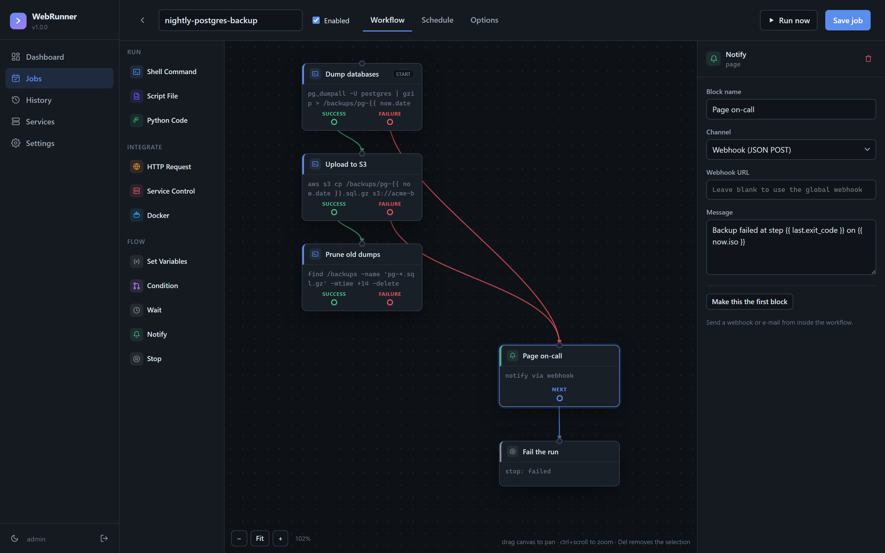
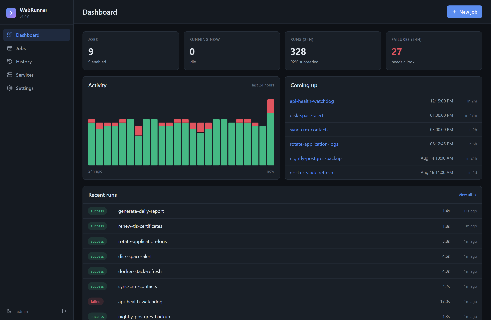
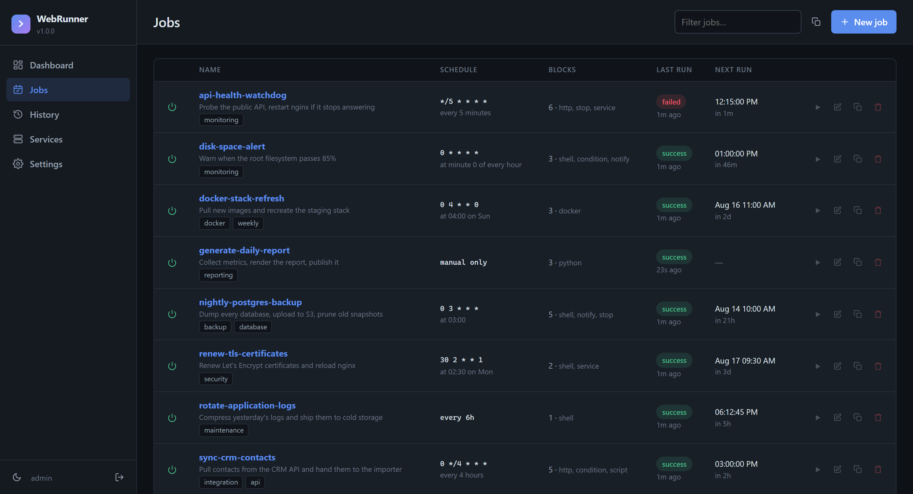
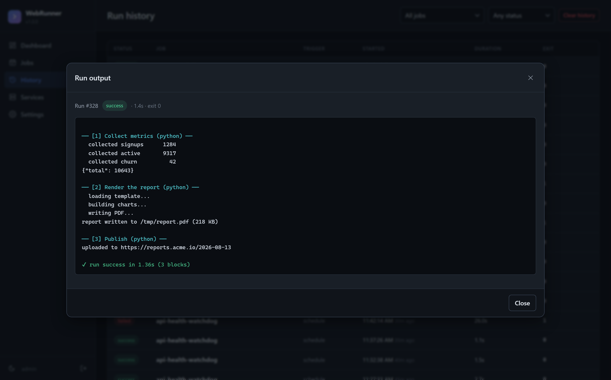
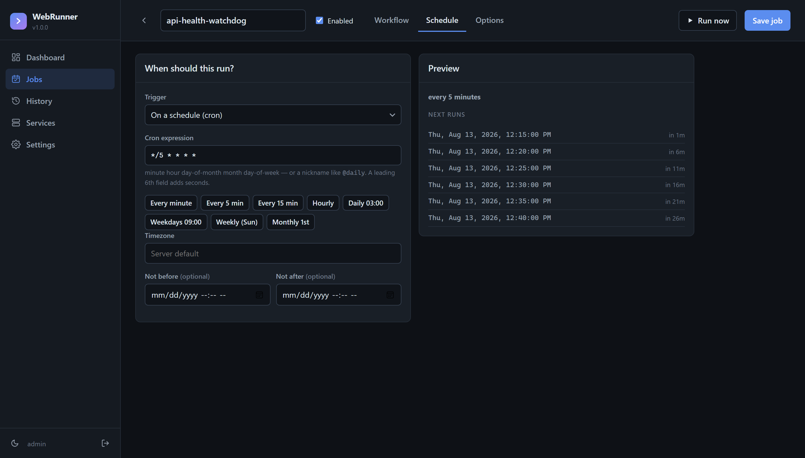
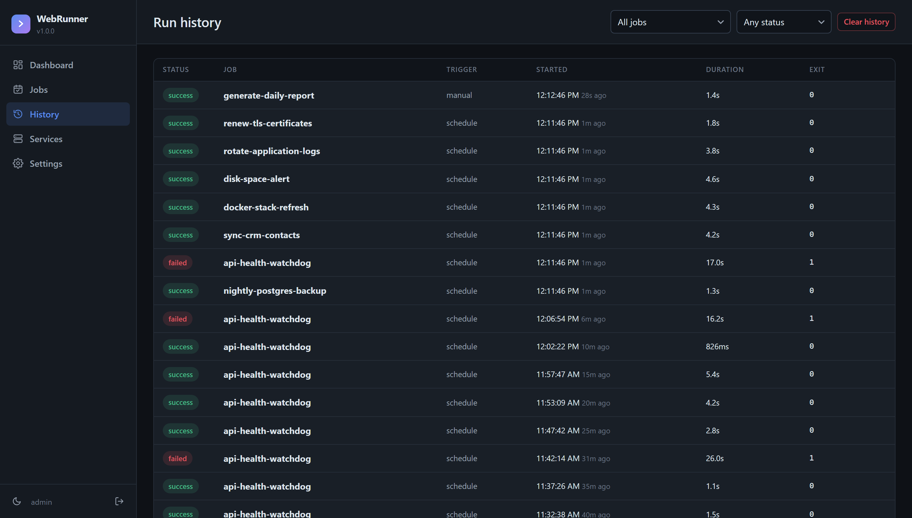

# WebRunner

A self-hosted job scheduler with a web dashboard. Schedule shell commands,
scripts, API calls and service restarts — and build multi-step workflows
visually, by dragging blocks onto a canvas and wiring them together.

Runs on Linux (primary target), Windows, and in Docker. Starts automatically on
boot. One SQLite file holds everything.



*A backup job: three steps down the happy path in green, and both failure
outputs routed to a pager in red. Click a block to configure it on the right.*

---

## Contents

- [What it does](#what-it-does)
- [Install](#install)
- [Building a job](#building-a-job)
- [Blocks](#blocks)
- [Templates and variables](#templates-and-variables)
- [Schedules](#schedules)
- [Reliability options](#reliability-options)
- [Secrets](#secrets)
- [REST API](#rest-api)
- [Command line](#command-line)
- [Configuration](#configuration)
- [Security](#security)
- [Troubleshooting](#troubleshooting)

---

## What it does

- **Visual workflow builder.** Compose jobs from blocks on a canvas. Drag from a
  block's output dot to another block to connect them. Branch on success or
  failure, loop, or stop early.
- **Real triggers.** Cron expressions (with seconds support), fixed intervals,
  a one-off date and time, or manual only. Per-job timezones.
- **Live output.** Watch a run stream into the browser as it happens, with
  colours preserved. Cancel a run mid-flight and the whole process tree dies.
- **Full history.** Every run is recorded with its output, exit code, duration,
  and per-block results.
- **Service control.** List and control systemd units, Windows services and
  Docker containers from the dashboard or from inside a workflow.
- **Retries, timeouts, concurrency policies**, catch-up after downtime, webhook
  and e-mail notifications.
- **REST API** for everything the dashboard can do, with bearer tokens.

No message broker, no external database, no build step for the front-end.
Three Python dependencies.

### The dashboard



Twenty-four hours of activity, what is due next, and what just ran.

### Jobs



Cron expressions are translated into plain English, so `30 2 * * MON-FRI` reads
as *at 02:30 on Mon, Tue, Wed, Thu, Fri* before you commit to it.

### Live output



Output streams into the browser as the job produces it, block by block, with
colour preserved. Cancel from here and the entire process tree is killed.

### Schedule preview



The next six fire times update as you type, so a wrong cron expression is
obvious before you save rather than at 3am.

### History



Every run is kept with its output, exit code, duration and per-block results.
Filter by job or status.

---

## Install

### Docker (recommended)

```bash
git clone https://github.com/ZDStudios/WebRunner.git
cd WebRunner
docker compose up -d
```

Then open <http://localhost:8770> and check the log for the generated password:

```bash
docker compose logs webrunner | head -20
```

`restart: unless-stopped` in `docker-compose.yml` is what brings it back after a
reboot. Mount anything your jobs need into the container — the compose file has
commented examples, including the Docker socket so jobs can manage other
containers.

### Linux (systemd)

```bash
git clone https://github.com/ZDStudios/WebRunner.git
cd WebRunner
sudo ./install.sh
```

This creates a virtualenv in `/opt/webrunner`, a `webrunner` system user, a
systemd unit, and starts it. It prints the first-run password when it finishes.

```bash
sudo ./install.sh --port 9000 --host 127.0.0.1 --user root
```

Useful afterwards:

```bash
systemctl status webrunner
journalctl -u webrunner -f
sudo ./uninstall.sh          # add --purge to delete the database too
```

### Windows

From an **elevated** PowerShell prompt:

```powershell
git clone https://github.com/ZDStudios/WebRunner.git
cd WebRunner
.\install.ps1
```

This installs into `C:\ProgramData\WebRunner` and registers a Scheduled Task
that starts WebRunner at boot as SYSTEM. Without elevation it falls back to
starting at logon instead.

```powershell
.\install.ps1 -Port 9000 -BindAddress 127.0.0.1 -OpenFirewall
.\install.ps1 -Uninstall
```

### From source, no service

```bash
pip install -r requirements.txt
python -m webrunner serve
```

Requires Python 3.10 or newer.

---

## Building a job

1. **Jobs → New job.** Give it a name.
2. **Click blocks in the left palette** to add them. Each new block is
   automatically wired onto the end of the chain.
3. **Select a block** to configure it in the right-hand panel. Fields change to
   match the block type.
4. **Connect blocks** by dragging from an output dot to another block. Drop on
   empty canvas to pick a new block to create there.
5. **Schedule tab** — choose a trigger. The preview shows the next six fire
   times so you can sanity-check a cron expression before saving.
6. **Options tab** — timeouts, retries, concurrency, notifications.
7. **Run now** saves and executes immediately, streaming the output.

Canvas controls: drag empty space to pan, `Ctrl`+scroll to zoom, `Fit` to frame
everything, `Delete` to remove the selected block, `Ctrl`+`S` to save. Click a
connection to remove it.

The block marked **START** runs first — change it from the inspector.

### How the flow works

Each block reports success or failure. WebRunner follows the matching output:

- **success** → carries on down that path.
- **failure** → follows the failure path **if you wired one**. If you did, the
  run continues and is not marked failed — you handled it. If nothing is
  connected to `failure`, the run stops there and is marked failed.
- **Keep going if this block fails** (inspector checkbox) treats a failure as
  success for routing purposes while still recording the block as failed.

A **Condition** block routes on `true`/`false` instead. A **Stop** block ends
the run immediately with the verdict you choose.

Cycles are allowed — useful for polling — but a run stops after 500 block
executions so a mistake cannot spin forever.

---

## Blocks

| Block | What it does |
|---|---|
| **Shell Command** | Runs a command through the system shell. Override the shell, working directory, environment, timeout and which exit codes count as success. |
| **Script File** | Runs an existing file on disk — `.py`, `.sh`, `.ps1`, `.js`, and more. The interpreter is detected from the extension, or set it explicitly. Pass arguments. |
| **Python Code** | Runs an inline Python snippet with the same interpreter as WebRunner. stdout becomes the block's output. |
| **HTTP Request** | Any method, custom headers and query parameters, JSON/form/raw bodies. Auth: bearer, basic, custom header or query parameter. Extract values from the JSON response into variables. Choose which status codes count as success. |
| **Service Control** | `start`, `stop`, `restart`, `reload`, `status`, `enable`, `disable` on systemd units or Windows services. |
| **Docker** | Start/stop/restart/pull/exec/logs a container, or `compose up`/`down`/`restart` a stack. |
| **Set Variables** | Define variables from templates for later blocks to use. |
| **Condition** | Compare two values — equals, contains, regex, numeric comparisons, empty checks — and branch. |
| **Wait** | Pause before continuing. |
| **Notify** | Send a webhook or e-mail from inside the workflow. |
| **Stop** | End the run here, marking it success or failed. |

Adding a block type is a single edit to `webrunner/blocks.py` — the dashboard
builds its palette and forms from that registry, so the UI needs no changes.

---

## Templates and variables

Any text field in any block can interpolate values with `{{ ... }}`:

```
{{ job.name }}                          the job's name
{{ run.id }}                            this run's id
{{ now.date }} {{ now.time }}           2026-08-13, 14:05:09
{{ vars.token }}                        a variable set earlier
{{ secrets.API_KEY }}                   a stored secret
{{ env.HOME }}                          an environment variable
{{ steps.fetch.stdout }}                that block's output
{{ steps.fetch.exit_code }}
{{ steps.fetch.status_code }}           HTTP blocks
{{ steps.fetch.json.data.token }}       walk into the JSON response
{{ steps.fetch.json.items.0.id }}       list index
{{ last.stdout }}                       the previous block
```

An unknown path renders as empty rather than failing the job. Supply a fallback
with `??`:

```
{{ vars.branch ?? "main" }}
```

Filters chain with `|`:

```
{{ steps.fetch.stdout | trim | upper }}
{{ steps.fetch.json.items | json }}
{{ vars.name | urlencode }}
```

Available: `json`, `upper`, `lower`, `trim`, `urlencode`, `b64`, `int`, `len`,
`first`, `last`, `lines`, `replace:a:b`, `slice:n`, `default:x`.

Variables are also exported to child processes as environment variables:
`vars.target` becomes `$WR_TARGET`, alongside `$WEBRUNNER_JOB_NAME`,
`$WEBRUNNER_RUN_ID` and `$WEBRUNNER_STEP_ID`.

### Example: call an API, then act on the answer

An **HTTP Request** block posting to an endpoint with a bearer token:

- URL `https://api.example.com/v1/deploys`
- Auth `Bearer` → `{{ secrets.DEPLOY_TOKEN }}`
- Body (JSON):
  ```json
  { "service": "web", "requested_by": "{{ job.name }}", "at": "{{ now.iso }}" }
  ```
- Extract → `deploy_id` = `data.id`

Then a **Condition** on `{{ steps.http.status_code }}` `==` `201`, wired
`true` → **Script File** running `/opt/scripts/finish_deploy.py` with arguments
`--id {{ vars.deploy_id }}`, and `false` → **Notify**.

---

## Schedules

**Cron** — the standard five fields, `minute hour day-of-month month day-of-week`:

```
0 3 * * *          03:00 every day
*/15 * * * *       every 15 minutes
30 2 * * MON-FRI   02:30 on weekdays
0 0 1 * *          midnight on the 1st
0 9,17 * * *       09:00 and 17:00
@daily @hourly @weekly @monthly @yearly @minutely
```

A sixth leading field adds seconds: `*/30 * * * * *` runs every 30 seconds.
Names work for months and weekdays (`JAN`, `MON`). When both day-of-month and
day-of-week are restricted, the job runs when **either** matches — the same rule
Vixie cron uses. `L`, `W` and `#` are not supported and are rejected clearly
rather than ignored.

**Interval** — every N seconds/minutes/hours/days, measured from the end of the
previous run.

**Date** — fires once at a specific date and time, then never again.

**Manual** — only when you press Run or call the API.

Set a timezone per job, or globally in Settings. `Not before` / `Not after`
bound when a schedule is active.

---

## Reliability options

- **Timeout** — kills the whole process tree, not just the parent.
- **Retries** — retry N times on failure, with a delay. Each attempt is its own
  run in the history.
- **If it is already running:**
  - *Skip* — drop the new run (recorded as skipped, so you can see it happened).
  - *Queue* — wait for the current run, then go.
  - *Run both at once*.
  - *Cancel the old run and restart*.
- **Run missed schedules after downtime** — if WebRunner was stopped when a job
  was due, run it once on startup. Off by default: missed runs more than two
  minutes late are skipped and logged.
- **Run as user** (Linux, requires running as root) — drop privileges for the
  job's processes.

---

## Secrets

Settings → Secrets stores API keys and passwords outside your job definitions.
Reference them as `{{ secrets.NAME }}`.

Values are never returned by the API, never rendered into the dashboard, and are
excluded from job exports — so you can share or version-control an export
safely. They are stored in the SQLite database in plain text, so protect the
data directory (the installers set it to mode 750).

---

## REST API

Interactive docs at `/api/docs`. Create a token in Settings → API tokens.

```bash
TOKEN=wr_xxxxxxxxxxxx
BASE=http://localhost:8770

curl -H "Authorization: Bearer $TOKEN" $BASE/api/jobs
curl -H "Authorization: Bearer $TOKEN" -X POST $BASE/api/jobs/3/run
curl -H "Authorization: Bearer $TOKEN" "$BASE/api/runs?status=failed&limit=10"
curl -H "Authorization: Bearer $TOKEN" $BASE/api/export > backup.json
```

Creating a job:

```bash
curl -H "Authorization: Bearer $TOKEN" -H "Content-Type: application/json" \
     -X POST $BASE/api/jobs -d '{
  "name": "nightly-backup",
  "trigger_type": "cron",
  "cron": "0 3 * * *",
  "timeout_seconds": 3600,
  "max_retries": 2,
  "steps": {
    "start": "backup",
    "nodes": [
      { "id": "backup", "type": "shell",
        "config": { "command": "restic backup /srv", "expect_exit": "0" },
        "edges": { "success": "prune" } },
      { "id": "prune", "type": "shell",
        "config": { "command": "restic forget --keep-daily 7 --prune" },
        "edges": {} }
    ]
  }
}'
```

Main endpoints: `/api/jobs` (GET, POST), `/api/jobs/{id}` (GET, PUT, DELETE),
`/api/jobs/{id}/run`, `/api/jobs/{id}/toggle`, `/api/jobs/preview`,
`/api/runs`, `/api/runs/{id}`, `/api/runs/{id}/cancel`, `/api/services`,
`/api/settings`, `/api/secrets`, `/api/export`, `/api/import`, `/healthz`.

Live streams: `WS /ws/events` for job and run events, `WS /ws/runs/{id}` for a
run's output as it is produced.

Cookie-authenticated writes additionally need an `X-CSRF-Token` header; bearer
tokens do not.

---

## Command line

```bash
webrunner serve                    # run the scheduler + dashboard
webrunner install                  # register the boot service for this install
webrunner uninstall
webrunner list                     # jobs, schedules, last and next run
webrunner exec nightly-backup      # run one job in the foreground, printing output
webrunner passwd [username]        # set a password (recovers a locked-out account)
webrunner export jobs.json
webrunner import jobs.json
webrunner version                  # version and resolved paths
```

`webrunner exec` is the quickest way to debug a job: it runs the workflow in
your terminal with the same engine the scheduler uses.

---

## Configuration

Everything is optional; environment variables win over defaults.

| Variable | Default | Meaning |
|---|---|---|
| `WEBRUNNER_DATA_DIR` | `/var/lib/webrunner`, `%PROGRAMDATA%\WebRunner`, or `~/.local/share/webrunner` | Database and key location |
| `WEBRUNNER_HOST` | `0.0.0.0` | Bind address |
| `WEBRUNNER_PORT` | `8770` | Port |
| `WEBRUNNER_SECRET` | generated, persisted | Session signing key |
| `WEBRUNNER_ADMIN_USER` | `admin` | First-run username |
| `WEBRUNNER_ADMIN_PASSWORD` | generated | First-run password |
| `WEBRUNNER_TZ` | system | Default timezone |
| `WEBRUNNER_SHELL` | `/bin/sh` or `cmd.exe` | Default shell for shell blocks |
| `WEBRUNNER_SESSION_DAYS` | `14` | Login lifetime |
| `WEBRUNNER_SECURE_COOKIE` | off | Set when serving over HTTPS |
| `WEBRUNNER_MAX_OUTPUT` | `524288` | Captured output cap per run, bytes |
| `WEBRUNNER_LOG_LEVEL` | `info` | `debug`/`info`/`warning`/`error` |
| `WEBRUNNER_AUTH_DISABLED` | off | Disables authentication entirely |

State lives in `webrunner.db` (SQLite, WAL mode) and `secret.key`. Back up the
data directory, or use `webrunner export` for a portable JSON copy of your jobs.

---

## Security

**WebRunner exists to run arbitrary commands on the machine it is installed on.
Anyone who can log into the dashboard can do anything the WebRunner process can
do.** Treat access as equivalent to a shell on that host.

What it does for you:

- Passwords hashed with PBKDF2-HMAC-SHA256, 310,000 iterations.
- Session cookies are `HttpOnly` + `SameSite=Strict`; state-changing requests
  from a browser session require a session-bound CSRF token.
- API tokens are stored only as SHA-256 digests and shown once.
- Login is constant-time against unknown usernames.
- Secret values are never returned by the API.
- Service and container names are validated before reaching a shell.

What you should do:

- **Do not expose it directly to the internet.** Bind to `127.0.0.1` and use a
  VPN, an SSH tunnel, or a reverse proxy that terminates TLS and adds its own
  authentication.
- Change the generated password, then delete `initial-password.txt`.
- Set `WEBRUNNER_SECURE_COOKIE=1` when serving over HTTPS.
- Run as a dedicated unprivileged user unless a job genuinely needs root.
  `install.sh` does this by default.
- Mounting `/var/run/docker.sock` into the container grants root on the host —
  convenient, and worth doing deliberately.
- `WEBRUNNER_AUTH_DISABLED=1` removes all authentication. Only ever use it on a
  loopback-bound socket on a machine you fully trust.

---

## Troubleshooting

**What is the login?** The username is `admin`. There is no fixed default
password — WebRunner generates one the first time it starts with an empty
database, prints it to the log, and writes it to `initial-password.txt` in the
data directory:

| Install | Where |
|---|---|
| Docker | `docker compose logs webrunner \| head -20` |
| Linux | `/var/lib/webrunner/initial-password.txt` |
| Windows | `C:\ProgramData\WebRunner\initial-password.txt` |

Set your own instead by exporting `WEBRUNNER_ADMIN_USER` and
`WEBRUNNER_ADMIN_PASSWORD` **before the first start**.

**There is no `initial-password.txt`.** It is only written on a genuinely first
run. If an account already exists in that data directory — because WebRunner
was started once before, or the installer was run twice — the file is never
created, and setting `WEBRUNNER_ADMIN_PASSWORD` afterwards has no effect
either. Passwords are stored hashed, so an existing one cannot be read back.
Set a new one:

```bash
sudo -u webrunner /opt/webrunner/venv/bin/webrunner passwd admin
```

```powershell
& 'C:\ProgramData\WebRunner\app\Scripts\webrunner.exe' passwd admin
```

It prompts for the new password and signs out existing sessions. To start over
completely, stop the service and delete `webrunner.db` from the data directory —
that also deletes your jobs and history.

**A job does not fire.** Check it is enabled and that `next_run` is in the
future on the Jobs page. Verify the cron expression with the Schedule tab's
preview. If the machine was asleep, missed runs are skipped unless the job has
catch-up enabled.

**A job works in my terminal but not in WebRunner.** It runs with a different
environment. `$PATH` in particular is often shorter — use absolute paths, or set
what you need in Settings → Global environment variables. Under Docker, the job
runs *inside the container*, so the tool must be installed there.

**Output does not stream.** Many programs buffer stdout when it is not a TTY.
Use `python -u`, `stdbuf -oL`, `PYTHONUNBUFFERED=1`, or your language's flush.
Output still arrives when the process exits.

**Services page is empty.** It needs `systemctl` (Linux), PowerShell (Windows)
or the `docker` CLI on `PATH`. In Docker, controlling *host* services requires
mounting the Docker socket; systemd units on the host are not reachable from
inside a container.

**Port already in use.** `webrunner serve --port 9000`, or change the compose
port mapping.

**Windows: timezone names are rejected.** Install the tz database:
`pip install tzdata` (the installers do this for you).

---

## Development

```bash
pip install -r requirements.txt
python -m webrunner serve --port 8770 --log-level debug --access-log
```

Layout:

```
webrunner/
  app.py          FastAPI routes, auth, WebSockets
  scheduler.py    trigger evaluation, concurrency, retries
  engine.py       walks the block graph, executes each block
  blocks.py       block registry — the one place to add a block type
  cronparse.py    dependency-free cron parser
  process.py      subprocess execution, streaming, kill-tree
  template.py     the {{ ... }} language
  services.py     systemd / Windows / Docker control
  db.py           SQLite schema and queries
  static/         style.css, app.js, builder.js (the node canvas)
  templates/      Jinja2 pages
```

## Licence

MIT — see [LICENSE](LICENSE).
